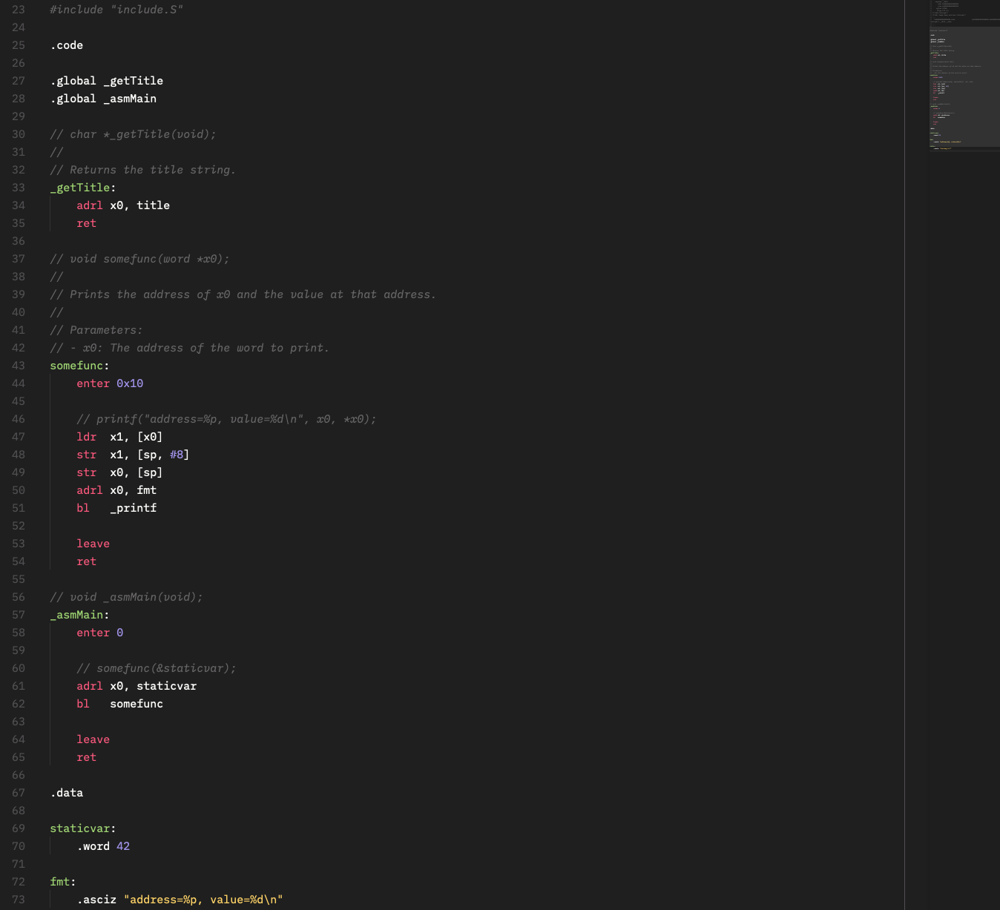

# gasfmt

[](https://github.com/0xdea/gasfmt)
[](https://crates.io/crates/gasfmt)
[](https://crates.io/crates/gasfmt)
[](https://twitter.com/0xdea)
[](https://infosec.exchange/@raptor)
[](https://github.com/0xdea/gasfmt/actions/workflows/build.yml)

> "Having to maintain two separate symbols whose values are dependent on one another is not a good thing in a program."
>
> -- Randall Hyde

A formatter for GNU assembler (GAS) sources, targeting the ARM64 dialect accepted by gas and clang. It is written in Rust and can be used as a library or a command-line tool.



## Style

Before:

```asm
_asmMain: stp x19,x20,[sp,#-0x10]!   // save registers
    enter 0x40
  // printf("Hello, world\n");
    adrl x0,fmt
    bl _printf
```

After:

```asm
_asmMain:
	stp   x19, x20, [sp, #-0x10]! // save registers
	enter 0x40
	// printf("Hello, world\n");
	adrl  x0, fmt
	bl    _printf
```

## Limitations

- Comment-only lines, assignments, and directives that don't emit data (e.g., `.balign`, `.global`) keep the
  indentation level chosen by the author, either none or one tab, because both are legitimate.
- Operand expressions aren't reformatted beyond whitespace runs and commas (e.g., `a+b` stays as it is).
- Lines holding `/* */` block comments, `;` statement separators, or a string literal that spans several lines are
  passed through unchanged. So are a line ending with a backslash and the line that continues it, except for the
  first line of a preprocessor directive.
- A string literal left open (e.g., by a stray `"` in a comment style that isn't recognized) makes the lines that
  follow pass through unchanged, up to the next `"`.
- Preprocessor directives are moved to column 0, so nested `#if` blocks lose their indentation.
- Other comment styles (e.g., `@` or a `#` that doesn't start a line) aren't recognized.

## Installing

The easiest way to get the latest release is via [crates.io](https://crates.io/crates/gasfmt):

```sh
cargo install gasfmt --locked
```

To install as a library, run the following command in your project directory:

```sh
cargo add gasfmt
```

## Compiling

Alternatively, you can build from [source](https://github.com/0xdea/gasfmt):

```sh
git clone --depth 1 https://github.com/0xdea/gasfmt
cd gasfmt
cargo build --release --locked
```

## Usage

Format files in place, printing the path of each file that was changed:

```sh
gasfmt [FILES]...
```

Only list the files that need formatting, exiting with a failure status if there are any:

```sh
gasfmt --check [FILES]...
```

Without files, gasfmt formats standard input to standard output, so that it can be used as an editor filter.

## Examples

Format all assembly sources in the current directory:

```sh
gasfmt *.S
```

Check them, e.g., in a CI job:

```sh
gasfmt --check *.S
```

Format a file to standard output without modifying it:

```sh
gasfmt < listing1-1.S
```

## Zed

To format assembly sources on save in the [Zed](https://zed.dev/) editor, make sure that gasfmt is in your `PATH`
and add it as an external formatter to your `settings.json`:

```json
{
  "languages": {
    "Assembly": {
      "formatter": {
        "external": {
          "command": "gasfmt"
        }
      },
      "format_on_save": "on"
    }
  }
}
```

Zed passes the buffer to gasfmt on standard input and replaces it with what gasfmt writes to standard output.

## Credits

- The style is the one of [my code](https://github.com/0xdea/AoAA) for
  [The Art of ARM Assembly Language](https://artofarm.randallhyde.com/) by Randall Hyde.

## Changelog

- [CHANGELOG.md](https://github.com/0xdea/gasfmt/blob/master/CHANGELOG.md)

## TODO

- Support other comment styles and architectures.
